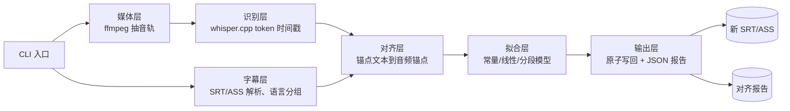
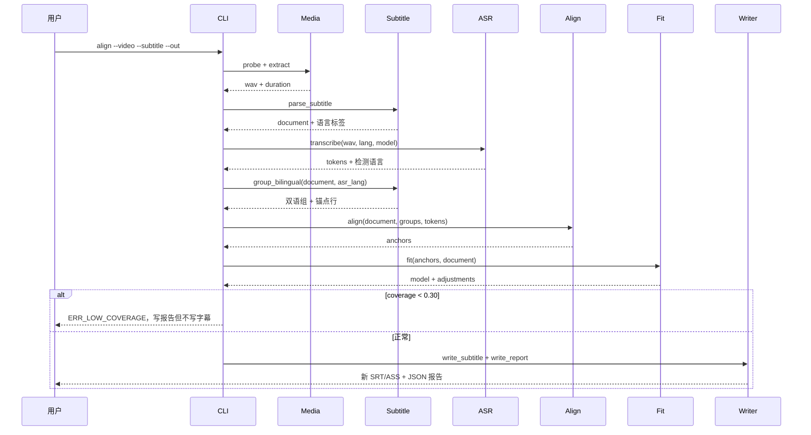

# SubAlign 字幕时间轴音频对齐 技术方案

| 字段 | 内容 |
| --- | --- |
| 标题 | SubAlign 字幕时间轴音频对齐 技术方案 |
| 主笔 | dream-365 |
| 评审人 | dream-365（自审）；本项目无下游系统依赖方，正式评审前由独立评审者复核 |
| 创建日期 | 2026-11-05 |
| 目标版本 | v0.1.0 |
| 关联资源 | 想法文档 `DGWTBTTZ`；外部依据见 7.8 |

## 1. 背景与上下文

### 1.1 系统现状

SubAlign 目前没有可运行实现；本节描述的是它要替代的人工流程。

个人观影的现状工作流是：

1. 从字幕站下载与片名匹配的 SRT 或 ASS。
2. 播放器加载字幕。若整体偏移，用播放器的「字幕延迟」功能以 100ms 或 500ms 为步长调整。
3. 调整后若后段再次错位，退出播放，用字幕编辑器逐行改时间轴，或换一个字幕版本重试。
4. 若新版本仍不匹配，放弃该字幕。

技术栈停留在「播放器 + 文本编辑器」：没有音频分析，没有语音识别，也没有任何自动对齐环节。字幕文件只被当作一串固定时间码，播放器也只把它当作一个可整体平移的文本层。

### 1.2 核心技术痛点

失败链如下：

1. 字幕文件来自另一片源，片头长度、帧率或剪辑点与手头视频不同。
2. 播放器把整条字幕视为一个整体，只提供单一全局延迟参数。
3. 前段对齐后，片源差异在后段累积；一次镜头切换、片头剪辑或广告断点就可能产生一个新的固定偏移。
4. 观影者每遇到一个断点就要暂停、重调、继续；断点数量随片源差异增加而增加。
5. 播放器的调整粒度与手动改轴的成本，使「逐段校正」在长片里不可行，最终只能放弃该字幕。

具体证据：2026-11 观看纪录片《印象派》时，同一份字幕文件在片头调 +2s 后对齐；播放到中段镜头切换后需要再 +2~3s；后续至少再出现一次跳变。影片文件与字幕文件均在本机，可复现。这不是一次性平移能解决的偏移，而是同一文件内多段不同偏移。

### 1.3 重构/设计动机

触发点就是上述《印象派》事故：它暴露了「全局延迟」这一交互模型在分段跳变面前的失效。

为什么现在做：

- token 级时间戳方案已经可用。whisper.cpp 能在本地对整部影片输出 token 级起止时间（启用 DTW 后），字幕行可以锚定到具体音频片段，而不是靠猜；单二进制、Metal 加速与离线模型也符合本机长片处理的约束。
- 消费级硬件已经够用。Apple Silicon 笔记本可以在可接受的时间内跑完一部长片，单点实验不再需要 GPU 服务器。
- 现有工具的能力边界已经清楚。ffsubsync、alass、AutoSubSync 能处理全局偏移、帧率漂移与带惩罚的分段切分，但它们的时间信号来自语音活动检测（VAD）或音频能量，不读取字幕文本；在静音、音乐和环境声较多的纪录片里，锚点会变稀。用字幕文本参与对齐，是一个尚未被这些工具覆盖的验证方向。

若推迟，下次遇到分段错位仍只能手动处理；随着同一部片子的片源版本增多，字幕与片源不匹配只会更常见。

### 1.4 非目标

不做的后果：继续维持「播放器全局延迟 + 手动改轴」，分段错位的片源实际上不可用；只能等待字幕站出现与手头片源完全匹配的版本，而这不受自己控制。

本次非目标：

- 不做 GUI、播放器插件或系统级字幕渲染集成。
- 不重排 ASS/SSA 的样式、定位与绘图指令，只改事件时间码；卡拉OK逐字标签的重算不在本次范围。
- 不修正字幕文本、翻译或错别字，只改时间码；中英双语只做锚点选择，不做翻译合并。
- 不做批量处理、服务化或多用户并发。
- 不处理硬字幕、无音轨视频与加密视频。
- 不承诺中英以外语言达到同等精度。

## 2. 目标与非目标

### 2.1 目标

按性质分组：可靠性类 G1–G4（精度、分段、不劣化、安全可追溯），性能类 G5。共 5 个目标。

- **G1 - 对齐精度**：在 300 行人工标注基准（覆盖整体平移、线性漂移、分段跳变三类，含 SRT 与 ASS、单语与中英双语）上，修正后每行起始时间的绝对误差中位数 ≤ 0.10s、P90 ≤ 0.20s；结束时间同口径。验收方式：`eval/precision.py` 按格式与语言分组输出误差分布，并人工抽查 30 行复核。
- **G2 - 分段跳变处理**：对注入的 10 个 ≥1.5s 断点，断点召回 10/10，断点位置误差 ≤ 2 行字幕；在 3 部真实片源上与 ffsubsync（启用 split 模式）和 alass 的 P90 误差相比不劣于基线。验收方式：注入实验脚本输出断点表，基线对比报告逐片列出 P90。
- **G3 - 不劣化**：对 6 个本来就对齐的 fixture（SRT/ASS 各 3 个，含中英双语），修正后 95% 的字幕行位移 ≤ 0.05s，且不新增断点；不满足时工具必须输出「无需修正」而不是写回。验收方式：回归测试断言位移分布、断点数与 ASS 非时间字段不变。
- **G4 - 安全与可追溯**：每次运行都不修改输入文件（运行前后 SHA-256 不变），并产出通过 JSON Schema 校验的报告；报告包含每行偏移、置信度、模型类型（constant / linear / piecewise）、断点位置、字幕格式、锚点语言与双语组 ID。验收方式：文件哈希断言 + 报告 Schema 测试。
- **G5 - 性能**：在 M2 MacBook（16GB）上，100 分钟 1080p 视频使用 whisper.cpp 的 large-v3-turbo GGML 模型，端到端 ≤ 30 分钟，峰值 RSS ≤ 8GB。验收方式：`benchmarks/run.sh` 计时并记录 `/usr/bin/time -l` 的峰值内存。

### 2.2 非目标

- **NG1 - 交互形态**：不做 GUI、播放器插件与拖拽式界面（本次不做）。
- **NG2 - ASS 高级特性**：不重算卡拉OK逐字标签、绘图指令与矢量动画的时间；遇到时保留原字段并按 4.6 告警（本次不做）。
- **NG3 - 文本内容**：不纠错、不重译、不合并或拆分字幕行（本次不做）。
- **NG4 - 批量与服务化**：不做目录批处理、队列、API 与多用户并发（Deferred to Phase 2）。
- **NG5 - 特殊输入**：不处理硬字幕、无音轨视频、加密或 DRM 视频（本次不做）。
- **NG6 - 多语言同等精度**：中英以外语言可以运行，但不承诺达到 G1 的精度指标（Deferred to Phase 2）。

## 3. 架构设计与核心方案

### 3.1 总体架构

全局分层、模块边界与技术栈见 `docs/architecture/system.md`（Approved）。本次变更全部落在 SubAlign 分析管线内部：整条管线都是新增的，外部系统与输入输出边界不变。



### 3.2 核心模块职责

- **CLI 入口**：解析参数、校验输入、编排阶段、映射退出码；不做任何算法判断。
- **媒体层**：探测视频时长与音轨，抽取 16kHz / 单声道 / PCM s16le WAV，管理临时文件；识别层只接受这一种格式，原始音轨不得直接送入 whisper.cpp。
- **字幕层**：解析 SRT 与 ASS/SSA，保留原文、行序、样式与事件字段，生成用于匹配的归一化文本；负责编码探测，写回时沿用输入编码与换行。
- **语言分组（字幕层子模块）**：按字符集标注每行语言（zh / en / mixed），把同一时间段的中英两行归为双语组，并按 ASR 语言选出锚点行。
- **识别层**：调用 whisper.cpp 产出 token 流（文本、起止时间、置信度）；按语言把原始 token 重组为对齐单元，模型与语言在此层固定，向上只暴露统一 token 流契约。
- **对齐层**：把每个字幕行或双语组选出的锚点文本与 token 流做相似度对齐，产出音频起止锚点、匹配率与置信度。
- **拟合层**：在常量、线性、分段常量三类偏移模型间做带复杂度惩罚的选择，产出每行修正量与断点。
- **输出层**：按模型写回新 SRT 或 ASS，保留非时间字段，生成 JSON 报告；保证输入只读、输出原子替换。
- **评估层**（离线）：维护人工基准、注入断点与基线对比脚本，不参与运行时决策。

### 3.3 核心数据流转

1. CLI 校验 `--video`、`--subtitle`、`--out` 三个路径，确认输出不存在或允许覆盖。
2. 媒体层探测音轨，抽取 16kHz / 单声道 / PCM s16le WAV；探测或格式校验失败立即返回媒体错误，不进入识别。
3. 字幕层解析 SRT 或 ASS，得到字幕行、归一化文本与语言标签；解析失败返回带行号的错误。
4. 识别层对 WAV 做 token 级识别，得到按时间排序的 token 流与检测到的语言。
5. 语言分组把同一时间段的中英两行归为双语组，按 ASR 语言选出锚点行；单语行直接作为锚点。
6. 对齐层把每个锚点文本匹配到 token 流的一个连续片段，产出锚点；匹配率过低的行标记为 low-confidence。
7. 拟合层用 high-confidence 锚点计算残差序列，选择常量、线性或分段模型，并为低置信行在同段内插值。
8. 输出层为每行计算最终起止时间，做非负与单调性修正，原子写出新 SRT 或 ASS；双语组内各行使用同一修正量。
9. 报告层写出每行的原时间、修正量、最终时间、置信度、锚点语言、双语组 ID 与所属分段；若覆盖率不足，管线在写回前终止。

### 3.4 关键选型与约束

- **选 whisper.cpp 的 DTW token 时间戳，而不是 WhisperX 的 wav2vec2 强制对齐**：whisper.cpp 是单二进制、可用 Metal 加速、GGML 模型可离线分发，已经是本机现有工具链；WhisperX 需要 Python/PyTorch 运行时，部署更重。代价是 whisper.cpp 的 token 时间戳来自 cross-attention/DTW，边界精度低于专用强制对齐，且随语言与音频质量波动。因此方案不把单个 token 的边界当作最终精度，而是用行级锚点、多行残差拟合与低置信插值抵消系统性偏差。识别层默认启用 DTW token 时间戳；关闭时退回启发式 token 时间戳，并在报告中标注。若实验发现 token 边界不足以支撑 G1，按附录 A 的兜底路径处理。详细对比见 7.5。
- **选显式的三类偏移模型，而不是黑箱回归**：常量、线性、分段常量分别对应「整体平移」「帧率漂移」「剪辑断点」三种真实成因，模型选择结果可直接写进报告并被人复核。细粒度拟合规则见 4.5。
- **SRT 与 ASS 都做，但 ASS 只改时间码**：ASS 是中文外挂字幕的主流格式，样式与定位必须保留；实现上只重写 `Dialogue` 行的 `Start` 与 `End` 字段，其余字节原样保留。卡拉OK逐字标签、绘图指令与矢量动画的时间重算留到 Phase 2。
- **双语字幕按 ASR 语言选锚点**：音频通常只有一种主语言；中英双语字幕中与 ASR 语言一致的那一行用于匹配，另一行跟随同一修正量，避免翻译行污染对齐。若两行都是混合语言，则用整行归一化文本匹配，并在报告中标记 `mixed`。
- **全程本地运行**：音视频不出本机，除首次下载模型外不访问网络；这是隐私约束，也是个人工具的部署前提。
- **精度优先于吞吐**：单文件、单进程、串行阶段；不引入队列与并行，避免为性能牺牲可解释性。

## 4. 详细设计

### 4.1 不变量

以下约束在整条管线中始终成立，任何阶段都不得违反：

1. 输入视频与输入字幕以只读方式打开，运行前后 SHA-256 不变。
2. 输出字幕的字幕行数、顺序与文本内容与输入逐字一致，只允许时间码变化。
3. 输出文件先写临时文件再重命名，失败时不留半成品。
4. 任一不可恢复错误发生时，不产生输出字幕文件。
5. 修正量必须来自选中的模型；低置信行只能插值或保持原位，不能凭空生成。
6. ASS 输出除 `Dialogue` 的 `Start`/`End` 外，`[Script Info]`、`[V4+ Styles]`、`[Fonts]`、`[Graphics]`、`Comment` 事件与 `Dialogue` 的其余字段逐字节一致。
7. 识别层输入固定为 16000 Hz、单声道、PCM signed 16-bit little-endian 的 WAV；ffprobe 校验不通过时重新编码或失败，不做隐式重采样。

### 4.2 输入输出契约

命令行形式：

```text
subalign align --video <path> --subtitle <path.srt|path.ass> --out <path.srt|path.ass>
               [--report <path.json>] [--lang <code|auto>]
               [--model <name>] [--max-offset <seconds>]
               [--dry-run] [--force]
```

| 参数 | 必填 | 默认 | 约束 |
| --- | --- | --- | --- |
| `--video` | 是 | — | 存在、可读、含至少一条音轨 |
| `--subtitle` | 是 | — | 存在、可解析的 SRT 或 ASS/SSA，编码为 UTF-8 / UTF-8 BOM / GB18030；语言可单语或中英双语 |
| `--out` | 是 | — | 与输入不同路径；扩展名必须与输入格式一致（不支持跨格式转换）；已存在时需 `--force`；父目录可写 |
| `--report` | 否 | `<out>.report.json` | 父目录可写 |
| `--lang` | 否 | `auto` | 音频主语言（ISO 语言码或 auto）；auto 由识别层判定，并用于双语字幕的锚点行选择 |
| `--model` | 否 | `large-v3-turbo` | 必须是 whisper.cpp 支持的 GGML 模型名 |
| `--max-offset` | 否 | `60` | 正数，秒；超过该值的全局偏移视为输入异常 |
| `--shift` | 否 | `0` | 秒；模型修正后统一加的常量偏移，正数表示字幕更晚；用于人工校准 |
| `--dry-run` | 否 | 关闭 | 只跑分析并写报告，不写输出字幕 |
| `--force` | 否 | 关闭 | 允许覆盖已存在的输出；不解除输入只读约束 |

### 4.3 数据模型与契约

| 实体 | 字段 | 类型 | 必填 | 校验 |
| --- | --- | --- | --- | --- |
| AsrToken | text | string | 是 | 归一化后非空 |
| AsrToken | start / end | float | 是 | `0 ≤ start < end ≤ 视频时长` |
| AsrToken | score | float | 否 | `[0, 1]`，缺失按 0 处理 |
| SubtitleDocument | format | enum | 是 | `srt / ass` |
| SubtitleDocument | cues | list[SubtitleCue] | 是 | 顺序与输入一致，不重排 |
| SubtitleDocument | raw_header | string | 是 | ASS 的 `[Script Info]` 等头部块原样保留；SRT 为空字符串 |
| SubtitleCue | index | int | 是 | `≥ 1` 且全文件唯一 |
| SubtitleCue | start / end | float | 是 | `0 ≤ start < end`；ASS 写入时四舍五入到 0.01s |
| SubtitleCue | text | string | 是 | 保留原始文本、换行与 ASS 标签 |
| SubtitleCue | normalized | string | 是 | 去 ASS 标签、去标点、统一空白后非空 |
| SubtitleCue | lang | enum | 是 | `zh / en / mixed`，按字符集判定 |
| SubtitleCue | group_id | int | 是 | `≥ 0`；无双语组时为 0 |
| BilingualGroup | group_id | int | 是 | `≥ 1`，全文件唯一 |
| BilingualGroup | cue_indices | list[int] | 是 | 至少两个 cue，时间范围重叠 |
| BilingualGroup | anchor_cue_index | int | 是 | 必须是组内成员，优先选择语言与 ASR 语言一致的行 |
| BilingualGroup | anchor_lang | enum | 是 | `zh / en / mixed` |
| Anchor | cue_index | int | 是 | 必须是该组的锚点行；单语行即自身 |
| Anchor | group_id | int | 是 | `≥ 0`，与 CueAdjustment 一致 |
| Anchor | audio_start / audio_end | float | 是 | `0 ≤ audio_start < audio_end` |
| Anchor | matched_ratio | float | 是 | `[0, 1]`，匹配词数 / 锚点文本词数 |
| Anchor | confidence | enum | 是 | `high / medium / low` |
| OffsetModel | kind | enum | 是 | `constant / linear / piecewise` |
| OffsetModel | intercept | float | 是 | 秒；常量模型即全局偏移 |
| OffsetModel | slope | float | 是 | 线性模型的每秒变化量；其他模型为 0 |
| OffsetModel | breakpoints | list[float] | 是 | 升序；piecewise 时至少一个，其他模型为空列表 |
| OffsetModel | rmse | float | 是 | `≥ 0`，单位秒 |
| CueAdjustment | cue_index | int | 是 | 对应唯一字幕行 |
| CueAdjustment | delta_start / delta_end | float | 是 | 秒；来自模型或插值 |
| CueAdjustment | final_start / final_end | float | 是 | `0 ≤ final_start < final_end` |
| CueAdjustment | confidence | enum | 是 | `high / medium / low` |
| CueAdjustment | segment_id | int | 是 | `≥ 0`；常量模型为 0 |
| CueAdjustment | group_id | int | 是 | `≥ 0`；双语组内各行相同 |
| CueAdjustment | anchor_lang | enum | 是 | 该行实际用于对齐的语言；未参与锚定为 `none` |
| RunReport | run_id | string | 是 | 每次运行唯一 |
| RunReport | format | enum | 是 | `srt / ass` |
| RunReport | coverage | float | 是 | `[0, 1]`，high-confidence 锚点覆盖的 cue 数 / 总 cue 数；双语组按组内全部 cue 计 |
| RunReport | adjustments | list[CueAdjustment] | 是 | 长度等于字幕行数 |
| RunReport | warnings | list[string] | 是 | 每条带错误码或告警码 |
| RunReport | stage_timings | object | 是 | 阶段名到秒数的映射 |

AsrToken 是识别层向上暴露的最小对齐单元：英文按词、中文按字或词。whisper.cpp 的原始 token 由适配层按语言重组，不向上泄漏；重组规则与模型名记录在报告中。

语言判定规则：一行中 CJK 字符占比 ≥ 0.5 记为 `zh`，拉丁字母占比 ≥ 0.5 记为 `en`，两者都未过半记为 `mixed`。双语组的判定条件是两个 cue 的时间范围重叠 ≥ 80%，且语言分别为 `zh` 与 `en`；组内按 ASR 语言选择锚点行，另一行不参与文本匹配，只跟随同一修正量。

报告的最小 JSON 形状（只列字段，不代表实现）：

```json
{
  "run_id": "string",
  "format": "srt",
  "coverage": 0.0,
  "model": {"kind": "constant", "intercept": 0.0, "slope": 0.0, "breakpoints": [], "rmse": 0.0},
  "adjustments": [
    {"cue_index": 1, "delta_start": 0.0, "delta_end": 0.0,
     "final_start": 0.0, "final_end": 0.0, "confidence": "high", "segment_id": 0,
     "group_id": 0, "anchor_lang": "zh"}
  ],
  "warnings": [],
  "stage_timings": {"media": 0.0, "asr": 0.0, "align": 0.0, "fit": 0.0, "write": 0.0}
}
```

### 4.4 接口与协议

模块间契约如下，均以数据对象传递，不共享可变状态：

| 模块 | 契约 | 输入 | 输出 | 失败语义 |
| --- | --- | --- | --- | --- |
| Media | `extract_audio(video) -> AudioInfo` | 视频路径 | 16kHz / 单声道 / PCM s16le WAV 路径、时长、采样率 | `ERR_NO_AUDIO` / `ERR_MEDIA_DECODE` / `ERR_MEDIA_FORMAT` |
| Subtitle | `parse_subtitle(path) -> SubtitleDocument` | SRT/ASS 路径 | 字幕文档（格式、cue、语言标签） | `ERR_SUBTITLE_PARSE`（带行号） |
| Subtitle | `group_bilingual(doc, asr_lang) -> list[BilingualGroup]` | 字幕文档、ASR 语言 | 双语组与锚点行 | 无组返回空列表 |
| Subtitle | `write_subtitle(doc, adjustments, out) -> WriteResult` | 字幕文档、修正量、输出路径 | 输出路径、写入字节数 | `ERR_OUTPUT_WRITE` |
| ASR | `transcribe(wav, lang, model) -> list[AsrToken]` | WAV、语言、GGML 模型名 | 按时间排序的 token 流 | `ERR_ASR_FAILED` |
| Align | `align(doc, groups, tokens) -> list[Anchor]` | 字幕文档、双语组、token 流 | 每行或组锚点 | 无锚点返回 low-confidence，不抛错 |
| Fit | `fit(anchors, cues) -> OffsetModel` | 锚点、字幕行 | 偏移模型 | `ERR_LOW_COVERAGE` / `ERR_AMBIGUOUS_FIT` |
| Fit | `apply(cues, model) -> list[CueAdjustment]` | 字幕行、模型 | 每行修正量 | 修正冲突写入 warnings |
| Report | `write_report(report, path) -> void` | 报告对象、路径 | JSON 文件 | `ERR_OUTPUT_WRITE` |

媒体层输出契约：容器为 WAV；编码为 `pcm_s16le`；采样率 16000 Hz；声道数 1。抽取后必须用 ffprobe 校验这四项，任一不符返回 `ERR_MEDIA_FORMAT`，不得把原始音轨或未归一化的 WAV 交给识别层。ffmpeg 的参数固定为 `-ar 16000 -ac 1 -c:a pcm_s16le`，不允许依赖输入文件原有编码。

CLI 退出码：

| 退出码 | 含义 | 是否产生输出字幕 |
| --- | --- | --- |
| 0 | 成功，或 `--dry-run` 成功 | 是 / dry-run 否 |
| 1 | 输入参数或路径非法 | 否 |
| 2 | 媒体解码或语音识别运行失败 | 否 |
| 3 | 锚点覆盖率不足，放弃修正 | 否 |
| 4 | 偏移模型歧义，默认不写回 | 否（`--force` 时写回并告警） |
| 5 | 输出已存在且未加 `--force` | 否 |
| 6 | 未预期内部错误 | 否 |

### 4.5 核心流程与时序

正常路径与覆盖不足的异常路径：



拟合规则（本方案的核心算法约束）：

1. **残差定义**：对每个 high-confidence 锚点，计算 `r_i = audio_start_i − subtitle_start_i`，单位为秒；按字幕时间排序。
2. **常量模型**：取 `r_i` 的中位数作为全局偏移。它对应「整体平移」成因。
3. **线性模型**：对 `r_i` 做稳健线性回归，得到 `r(t) = a + b·t`；斜率 `b` 对应帧率比例偏差。校正后 RMSE 比常量模型下降 ≥ 30ms 时接受；斜率显著性作为诊断信息，不单独作为硬门槛。
4. **分段常量模型**：先按局部中位数剔除离群锚点，再对平滑后的残差做变点检测；每个分段至少包含 3 个 high-confidence 锚点，段内偏移取中位数。断点位置取相邻两个字幕行之间。
5. **模型选择**：按「常量 → 线性 → 分段」的复杂度顺序比较；更复杂模型只有在校正后 RMSE 下降 ≥ 30ms 时才被接受，否则退回更简单模型。分段模型由鲁棒局部中位数给出；若分段没有优于线性，保留线性或常量，不因断点抖动阻断写回。
6. **低置信行处理**：`matched_ratio < 0.6` 或锚点落在低分词上的行标记为 low-confidence；其修正量取同一分段内最近 high-confidence 行的插值。若同段没有 high-confidence 锚点，保持原时间并在报告中告警。
7. **时间修正**：每行 `final_start = start + delta`，`final_end = end + delta`，`delta` 来自选中的模型；锚点只用于模型拟合与置信度统计，不直接写回。起止使用同一偏移，原有时长与间隔保持不变，因此不额外做全局重叠推移——ASS 中刻意重叠的排版事件不应被级联推开。修正后强制 `final_start ≥ 0`、`final_end > final_start`；起点为负的 cue 夹紧到 0 并保留时长，写 `WARN_CLAMPED`。若指定 `--shift`，在应用前把该常量加到模型：constant/linear 加到截距，piecewise 加到每个分段偏移。
8. **双语组修正**：组内各行使用锚点行的同一组 `delta_start` / `delta_end`；锚点语言与 ASR 语言不一致时，优先选择匹配率最高的行；若组内所有行匹配率 < 0.6，整组标记 low-confidence。
9. **ASS 写回精度**：时间四舍五入到 0.01s；`Dialogue` 的 `Start`/`End` 之外字段不改；卡拉OK事件若 `delta_start ≠ delta_end`，保留原时间并写 `WARN_ASS_KARAOKE`。

### 4.6 异常处理与错误码

| 错误码 | 触发场景 | 处理策略 | 退出码 |
| --- | --- | --- | --- |
| `ERR_INPUT_INVALID` | 路径不存在、`--out` 与输入相同、输出扩展名与输入格式不一致、`--max-offset ≤ 0` | 打印具体参数，拒绝运行 | 1 |
| `ERR_OUTPUT_EXISTS` | 输出文件已存在且未加 `--force` | 提示改用新路径或 `--force` | 5 |
| `ERR_NO_AUDIO` | 视频没有音轨 | 停止，报告媒体信息；不生成临时 WAV | 2 |
| `ERR_MEDIA_DECODE` | ffmpeg 无法解码音轨 | 保留 stderr 摘要，清理临时文件 | 2 |
| `ERR_MEDIA_FORMAT` | 抽取结果不是 16kHz / 单声道 / `pcm_s16le` WAV | 删除临时文件，不进入识别；报告 ffprobe 实际格式 | 2 |
| `ERR_SUBTITLE_PARSE` | SRT/ASS 时间码或事件格式错误、序号不连续、空文件 | 报告格式与首个错误行号，不进入识别 | 1 |
| `ERR_ASR_FAILED` | 模型加载失败、显存/内存不足、识别进程崩溃 | 清理临时文件，报告阶段与原因 | 2 |
| `ERR_LOW_COVERAGE` | high-confidence 锚点占比 < 30% | 写报告，不写字幕；提示检查语言或片源 | 3 |
| `ERR_AMBIGUOUS_FIT` | 保留给未来其他分段方法；当前鲁棒分段模型不主动触发 | 保留错误码与退出码 | 4 |
| `ERR_OUTPUT_WRITE` | 磁盘满、权限不足、临时文件重命名失败 | 删除临时文件，保留原文件 | 2 |
| `ERR_INTERNAL` | 未分类异常 | 记录堆栈到日志，清理临时文件，不写输出 | 6 |

告警码（不阻断运行，但必须写入报告）：

| 告警码 | 触发场景 | 处理策略 |
| --- | --- | --- |
| `WARN_LOW_MATCH` | 单个 cue 的 `matched_ratio < 0.6` | 该行标记 low-confidence，用同段插值 |
| `WARN_MIXED_ANCHOR` | 双语组内两行都是 `mixed`，只能整行匹配 | 记录组 ID 与匹配率，人工复核 |
| `WARN_CLAMPED` | 修正后时间为负或与相邻行重叠 | 夹紧到合法区间，记录原值与最终值 |
| `WARN_ASS_KARAOKE` | 卡拉OK事件的 `delta_start ≠ delta_end` | 保留原时间，不重算逐字标签 |
| `WARN_NO_DTW` | whisper.cpp 未启用 DTW token 时间戳 | 记录回退原因与精度影响 |

## 5. 非功能性需求

### 5.1 性能与资源

- **端到端耗时**：100 分钟 1080p、whisper.cpp large-v3-turbo GGML、M2 16GB，≤ 30 分钟。[estimated]
- **峰值内存**：同上环境，峰值 RSS ≤ 8GB。[estimated]
- **临时磁盘**：单次运行 ≤ 2GB（16kHz 单声道 WAV 约 190MB/100 分钟，余量留给模型与缓存）。[estimated]
- **非识别阶段开销**：媒体探测、字幕解析、对齐、拟合、写回合计 ≤ 60 秒/100 分钟片。[estimated]

### 5.2 精度与可靠性

- **精度目标**：以 G1 为准；中位数 ≤ 0.10s，P90 ≤ 0.20s，按行分别统计起始与结束。
- **不劣化**：以 G3 为准；已对齐 fixture 上 95% 行位移 ≤ 0.05s，断点数不增加。
- **确定性**：同一输入、同一模型、同一版本、同一随机种子下，两次运行的 `adjustments` 逐行一致；识别层若使用非确定性算子，必须在报告中记录。
- **原子性**：输出先写同目录临时文件，`fsync` 后重命名；进程被中断时最多留下临时文件，不留下半截字幕文件。
- **幂等性**：对已修正过且模型应判为 constant/0 的字幕再次运行，逐行 `|delta| ≤ 0.05s`，报告模型为 `constant` 且 `intercept` 接近 0。

### 5.3 可观测性

- **结构化报告**：每次运行产出 4.3 定义的 JSON 报告，字段完整率 100%；报告通过仓库内 JSON Schema 校验。
- **阶段计时**：报告记录 `media`、`asr`、`align`、`fit`、`write` 五个阶段的秒数，精度到 0.01s。
- **日志**：日志写 stderr，包含 `run_id`、阶段名、错误码；禁止用裸 `print` 输出诊断信息。
- **告警**：每条 warning 必须带码（如 `WARN_LOW_MATCH`、`WARN_CLAMPED`），不得只写自然语言。

### 5.4 安全与隐私

- **本地优先**：运行期不向任何远端发送音视频、字幕或报告；仅首次下载模型时访问网络，且需显式触发。
- **输入保护**：输入文件以只读打开，运行前后 SHA-256 必须一致；写回目标与输入路径相同时直接拒绝。
- **临时文件**：成功、失败、中断三条路径都清理临时 WAV；`--keep-temp` 仅用于调试且必须在报告中显式记录。
- **依赖与模型**：依赖版本写入 lock 文件；报告记录 whisper.cpp 版本、GGML 模型文件名与 SHA-256、ffmpeg 版本，便于复现。
- **无遥测**：不采集使用数据，不写用户目录以外的路径。

### 5.5 兼容性

- **主运行环境**：macOS 14+、Apple Silicon、Python 3.11。
- **外部依赖**：ffmpeg/ffprobe ≥ 6.0；whisper.cpp ≥ 1.7，GGML 模型文件（如 `ggml-large-v3-turbo.bin`）随版本记录。
- **媒体输入**：容器与编码不限（mp4、mkv、avi 等）；统一转成 16kHz / 单声道 / PCM s16le WAV 后再识别，识别层不接受原始音轨或 MP3/AAC 等压缩格式。
- **字幕格式**：支持 SRT 与 ASS/SSA（v4+）；输出格式与输入一致，ASS 仅重写 `Dialogue` 的 `Start`/`End`，其余字段原样保留。
- **字幕编码与换行**：输入自动识别 UTF-8、UTF-8 BOM、GB18030；输出沿用输入的编码、BOM 与换行风格，不做转码。这样 4.1 要求的 ASS 非时间字段逐字节一致才成立。
- **语言**：支持中文（含简繁字符）与英文；中英双语 cue 可同文件共存。简繁不自动转换，覆盖率异常时在报告中提示检查简繁差异。
- **不支持项**：ASS 卡拉OK逐字标签的时间重算、矢量绘图动画、硬字幕、无音轨视频、DRM 视频；遇到时保留原字段并按 4.6 告警或返回错误。

## 6. 上线与迁移计划

### 6.1 发布与灰度

发布形态：本地 CLI，git tag `v0.1.0`，通过 `uv tool install` 或源码虚拟环境安装；不提供常驻服务。

灰度按「写回权限」逐级放开，而不是按流量：

1. **报告模式**：在 8 个 fixture 与 1 部真实影片上只跑 `--dry-run`，检查覆盖率、模型类型、断点、逐行偏移与双语锚点选择；此阶段不产生任何字幕文件。
2. **单片写回**：对《印象派》写回一次，人工逐段比对；记录每段实际偏差与报告值的差。
3. **日常使用**：连续处理 5 部影片，逐部记录是否需要手动回退。

阶段推进条件：上一阶段没有出现「输入被修改」「已对齐字幕被改坏」「断点误判导致整段偏移」三类事故。观察指标：报告覆盖率、选中模型、人工判定「可看」的比例、手动回退次数。

### 6.2 数据迁移与兼容性

无需数据迁移：本工具不维护数据库、不保存历史状态，每次运行都是「输入文件 → 新输出文件」。

兼容策略：

- 输入字幕只读，输出必须为新路径；不支持原地覆盖，因此不存在旧数据被改写的迁移风险。
- 输出保持原文本、原行序、原行数，只改时间码；下游播放器与字幕编辑器可按原格式读取。
- 字幕编码沿用输入（含 BOM 与换行风格）；原文件若为 GB18030，输出仍为 GB18030，字符内容不变。
- ASS 非时间字段原样复制，不做 SRT↔ASS 格式转换；格式不一致时按 4.6 拒绝。

### 6.3 上线验证与冒烟

冒烟清单：

1. `python -m pytest -q`：单元测试与 fixture 回归全部通过。
2. `subalign align --dry-run` 跑 8 个 fixture：整体平移、线性漂移、三段跳变、已对齐，各含 SRT 与 ASS；其中至少 4 个为中英双语。检查退出码均为 0，报告模型分别为 `constant`、`linear`、`piecewise`、`constant`。
3. 对临时 WAV 执行 ffprobe，断言 `codec_name=pcm_s16le`、`sample_rate=16000`、`channels=1`；人为喂入 44.1kHz 立体声输入时，管线应返回 `ERR_MEDIA_FORMAT` 或自动重编码为合规 WAV，二者都必须被测试覆盖。
4. 对已对齐 fixture 检查 `max(|delta|) ≤ 0.05s`，断点数为 0；ASS fixture 额外检查非时间字段逐字节不变。
5. 对 2 个双语 fixture 检查：锚点行语言与 ASR 语言一致，组内各行 `delta_start` 相同。
6. 对真实影片跑一次 `--dry-run`，人工抽查 30 行的 `final_start` 与播放器画面是否一致。
7. 校验报告 JSON 通过仓库内 Schema；校验输入文件 SHA-256 未变。

观察指标：退出码分布、`coverage`、选中模型、`warnings` 数量、人工抽查通过率。任一项低于 6.1 的推进条件即停止并回退。

### 6.4 回滚与熔断

回滚触发条件（可观测）：

- 回归集上任一 fixture 出现 ≥5% 的字幕行位移 > 100ms，或新增断点 ≥1 个。
- 输入文件 SHA-256 在运行前后不一致。
- 输出字幕文件无法被播放器、`pysubs2` 或 ASS 解析器读取。
- 覆盖率 < 30% 却仍然产生了输出字幕文件。
- 同一影片连续两次运行选中的模型类型不同，且断点位置差 > 2 行。

回滚步骤：

1. 删除本次产生的输出字幕与报告；输入文件从未被写入，无需恢复。
2. 回退版本：已发布过上一版本时，执行 `git checkout <上一 tag>` 或 `uv tool install subalign==<上一版本>`；首版尚无上一版本时，执行 `git checkout <发布前提交>`，或直接 `uv tool uninstall subalign` 回到未安装状态。
3. 用 6.3 的冒烟清单重跑 8 个 fixture，确认行为回到上一版本。
4. 在 `changelog.md` 记录触发条件、影响文件与回退版本。

## 7. 替代方案与权衡

针对「如何获得字幕行的音频时间基准」，评估了 Status Quo 与三个备选方案，最终选择方案 D。

### 7.1 Status Quo：播放器全局延迟 + 手动改轴

- **思路**：维持现有工作流，用播放器的字幕延迟参数做整体平移，必要时手动编辑 SRT。
- **优点**：零开发成本，播放器即用；对整体平移且无断点的片源足够。
- **成本与风险**：每个断点都要暂停重调；长片的分段校正不可行；手动改轴无法保证 0.1s 精度；最终常见结果是放弃字幕。触发阈值已经在 1.2 的事故中出现：同一文件内出现两次以上跳变，该流程即失效。

### 7.2 方案 A：ffsubsync / alass / AutoSubSync

- **思路**：把字幕时间轴与音频的语音活动（VAD）或能量包络做互相关，求全局偏移；较新版本通过 split 惩罚或动态规划支持分段。
- **优点**：成熟、快、无需 ASR；对全局偏移与常见帧率比例处理稳定；alass 与 ffsubsync 的 split 模式已能覆盖部分断点场景。
- **淘汰为唯一方案的原因**：时间信号来自「有声/无声」，不读取字幕文本；字幕行边界只能近似到语音段边界，难以稳定到 0.1s；分段需要调 split 惩罚，不同片源要换参数；静音、音乐与环境声多的纪录片会使 VAD 锚点变稀；不提供逐行置信度，出错时无法定位。它仍是本方案必须对照的基线，见 G2。

### 7.3 方案 B：aeneas 类「文本直接强制对齐音频」

- **思路**：不跑 ASR，直接把已知字幕文本按发音词典强制对齐到音频。
- **优点**：不受识别转写错误影响；文本完全已知。
- **淘汰原因**：依赖准确的发音词典与文本-音频一一对应假设；长片中背景音乐、音效与多人重叠会破坏对齐；公开对比中 aeneas 的中位结束边界误差约 2s（见 7.8）；对中文需要额外的分词与拼音词典工程，超出本次范围。

### 7.4 方案 C：纯文本或 LLM 对齐

- **思路**：用另一份已知正确的字幕作参考，或让语言模型根据上下文推断偏移。
- **优点**：不需要音频模型；实现轻。
- **淘汰原因**：本场景缺少的正是「与手头片源匹配的参考字幕」；语言模型没有硬时间基准，只能猜；对分段跳变无法给出可验证的断点位置。它解决的是文本相似度，不是时间对齐。

### 7.5 方案 D：whisper.cpp token 级时间戳 + 字幕文本对齐 + 分层偏移模型（当前选型）

- **思路**：whisper.cpp 提供 token 级硬时间基准，字幕文本提供干净的句子边界；行级锚点后，用常量/线性/分段三类模型解释残差。
- **优点**：单二进制、Metal 加速、GGML 模型可离线分发，与本机现有工具链一致；时间基准来自音轨本身，不依赖参考字幕；文本参与匹配，静音与音乐段不会让锚点完全消失；分段由残差变点检测自动给出，不需要按片调 split 惩罚；逐行置信度可写进报告。
- **代价**：token 时间戳来自 cross-attention/DTW，边界精度低于 wav2vec2 强制对齐，且随语言与音频质量波动；识别错误会污染锚点，必须靠匹配率与低置信插值兜底；首次使用需下载 GGML 模型。
- **对照方案**：WhisperX 的 wav2vec2 强制对齐边界更准，但需要 Python/PyTorch 运行时与更重的部署；本机已有 whisper.cpp 工作流，因此不把它作为首版主路径。若实验证明 token 边界不足以支撑 G1，再评估追加独立强制对齐阶段（Deferred to Phase 2）。
- **精度风险**：G1 的 0.1s 是实验目标，不是已知结论。首轮实验先测实际分布；若 P90 明显超出目标，优先加强行级拟合与插值，其次再考虑追加对齐阶段，不直接放宽 G1。
- **与 Goals 的对应**：G1 由行级锚点与整段拟合支撑；G2 由变点检测支撑；G3 由「宁可不改」与已对齐回归支撑；G4 由报告与原子写回支撑；G5 由单进程串行与 WAV 预处理约束。

### 7.6 格式与语言策略：不转换格式，按语言选锚点

- **思路**：直接读写 SRT/ASS 原格式；ASS 只替换 `Dialogue` 的 `Start`/`End`，其余字段逐字节保留。
- **放弃的方案**：统一转成 SRT 再处理，最后转回 ASS。优点是解析路径单一；淘汰原因是 ASS 的样式、定位、字体与特效在往返转换中会丢失或漂移，而「保留样式的同时修时间」正是本场景的硬需求。
- **双语策略**：不把中英两行合并成一段再匹配，也不让翻译行参与相似度计算；按 ASR 语言选出内容行作为锚点，译文行跟随同一修正量。这样锚点信号来自与音频一致的语言，避免译文降低匹配率。
- **代价**：ASS 事件字段顺序与时间精度（0.01s）需要专门的解析与写回实现；双语分组需要处理时间重叠与语言判定的边界情况。

### 7.7 权衡矩阵

| 维度 | Status Quo | A：VAD 对齐 | B：文本强制对齐 | C：纯文本/LLM | D：whisper.cpp + 文本 |
| --- | --- | --- | --- | --- | --- |
| 行级 0.1s 潜力 | 差 | 中 | 中 | 差 | 中高（待测） |
| token/词边界精度 | 不适用 | 中 | 中 | 差 | 中 |
| 分段跳变自动化 | 差 | 中（需调参） | 差 | 差 | **好** |
| 静音/音乐鲁棒性 | 不适用 | 差 | 中 | 不适用 | **好** |
| 无需参考字幕 | 是 | 是 | 是 | 否 | **是** |
| 运行成本 | 低 | **低** | 中 | 低 | 中 |
| 实现复杂度 | 低 | 低 | 高 | 低 | 中 |
| 逐行可解释性 | 差 | 差 | 中 | 差 | **好** |
| 契合当前阶段 | 否 | 部分 | 否 | 否 | **是** |

结论：方案 D 的 ASR 成本高于 VAD 方案，且 token 边界精度不如专用强制对齐，但它是唯一同时满足「无参考字幕」「分段自动检测」「逐行可复核」三项约束的方案；方案 A 作为基线保留在 G2 的对比实验中，而不是被否定。

### 7.8 外部依据

- ffsubsync 的 VAD/互相关与全局偏移定位：<https://pypi.org/project/ffsubsync/>
- alass 的分段对齐能力：<https://github.com/kaegi/alass>
- whisper.cpp 的 DTW token 时间戳：<https://github.com/ggerganov/whisper.cpp>
- WhisperX 的词级时间戳与强制对齐（对照方案）：<https://github.com/m-bain/whisperX>
- 多种强制对齐工具的词边界误差对比（WhisperX 常见 60–150ms，aeneas 中位结束边界误差约 2s；用于说明 token 时间戳与强制对齐的精度差异）：<https://jishuzhan.net/article/2099666343898042370>

## 附录 A：未决问题

| 问题 | 当前默认 | 影响 |
| --- | --- | --- |
| 片源存在整段删减，字幕中有无法锚定的行时怎么处理 | 保留原文与原时间，标记 low-confidence，不删除 | 决定 G1 的基准是否排除这些行；首版按「保留并报告」验证 |
| whisper.cpp 的 token 时间戳是否足以支撑 G1 | 先按 G1 实测；不达标先加强行级拟合与插值，再评估追加独立强制对齐阶段 | 决定是否需要引入 WhisperX 类的强制对齐作为可选阶段 |
| 中英以外语言在 whisper.cpp 下的对齐精度 | 只保证中英精度；其他语言可运行但不承诺 G1 | 决定 5.5 兼容性声明的边界 |
| 中英两行时间不完全重叠时的分组阈值 | 重叠 ≥ 80% 才归为双语组；否则各自独立对齐 | 决定 G1 中双语样本的统计口径 |
| ASS 卡拉OK逐字标签是否需要重算时间 | 首版保留原字段；事件两端修正量相同时整体平移，不同时告警跳过 | 决定 Phase 2 是否需要解析 `\k` / `\kf` / `\ko` 序列 |
